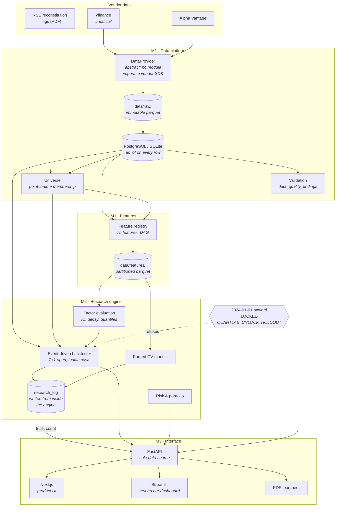

# QuantLab

A quantitative research platform for **Indian equities (NSE)**. QuantLab ingests
historical daily OHLCV, constructs point-in-time universes (NIFTY 50/100/500),
engineers alpha factors as a DAG registry, evaluates statistical relationships,
backtests strategies under realistic Indian transaction costs, analyses portfolio
risk, and serves results through a FastAPI-backed interface.

The deliverable is a **defensible research finding**, not a feature demo. A
documented negative result is a success; an impressive dashboard reporting an
unverifiable Sharpe is not. See [`docs/PRD.md`](docs/PRD.md) for the full
specification, [`CLAUDE.md`](CLAUDE.md) for the fixed architectural decisions and
binding research-integrity rules, and [`docs/methodology.md`](docs/methodology.md)
for how each integrity claim is enforced in code.

---

## Architecture



Two properties of that diagram are load-bearing:

- **`research_log` feeds the API's trials count.** No Sharpe leaves the API
  without the number of trials behind it and its deflated value. The count is
  read from the log, never supplied by a caller.
- **The holdout lock sits in front of the backtester**, not beside it. It is
  checked independently at the `DataHandler`, the submission endpoint and the log.

---

## Quickstart

Verified from a clean clone. Requires **Python 3.11** and, for the UI, **Node 20**.

### 1. Install

```bash
git clone https://github.com/RahulPrajapat001/QuantLabs.git
cd QuantLabs

python -m venv .venv
# Windows: .venv\Scripts\activate
source .venv/bin/activate

pip install -e ".[dev,data,research,api,reports,dashboard]"
cp .env.example .env
```

SQLite is the default and needs no configuration. For PostgreSQL, add
`.[postgres]` and set `QUANTLAB_DATABASE_URL` in `.env`.

> **PDF tearsheets** need Pango and Cairo, which are system libraries rather than
> Python packages. Without them `pip install weasyprint` succeeds and the first
> render fails. On Debian/Ubuntu:
> `sudo apt-get install libcairo2 libpango-1.0-0 libpangocairo-1.0-0 libgdk-pixbuf-2.0-0 shared-mime-info`.
> The Docker image installs them; `docker compose` renders a PDF on startup to
> prove it.

### 2. Create the schema

```bash
alembic upgrade head
```

### 3. Ingest, build features, validate

```bash
quantlab ingest --tickers RELIANCE.NS,TCS.NS,INFY.NS --start 2015-01-01
quantlab universe build --index NIFTY500      # needs cached NSE filings, see below
quantlab features build --universe NIFTY500
quantlab validate                             # writes data_quality_findings
```

`universe build` reads NSE reconstitution PDFs cached under `reference_dir`, named
`{INDEX}_{YYYY-MM-DD}.pdf`. Without them, membership cannot be reconstructed
point-in-time and the survivorship defence does not apply.

### 4. Run it

```bash
quantlab serve                                # http://127.0.0.1:8000/docs
streamlit run dashboard/Overview.py           # http://localhost:8501
cd frontend && npm install && npm run dev     # http://localhost:3000
```

Or the whole stack on PostgreSQL:

```bash
docker compose up --build
```

### 5. Verify

```bash
pytest                                        # full suite
pytest tests/feature_engineering/test_lookahead.py -v   # the look-ahead gate
mypy                                          # strict on src/
ruff check .
python scripts/build_design_tokens.py --check  # design tokens in sync
python scripts/build_data_dictionary.py --check # data dictionary in sync
```

---

## The two interfaces

QuantLab ships **two** frontends over one API. This is not duplication — it
mirrors how quant shops operate, where the person who wrote the strategy and the
person reading its results need different things.

| | **Streamlit** (`dashboard/`) | **Next.js** (`frontend/`) |
|---|---|---|
| Audience | **Researcher-facing** — the person who ran it | **Product-facing** — everyone else |
| Optimised for | Speed of iteration | Speed of comprehension |
| Shows | Raw numbers, full tables, every column | The finding, with its caveat attached |
| Cost of a new view | Minutes | Hours |
| Styling | Deliberately plain | Designed against [`docs/DESIGN_SYSTEM.md`](docs/DESIGN_SYSTEM.md) |

A researcher checking whether an IC survived a window change wants the number and
the table immediately; building that in React would cost an afternoon and still be
the worse tool. A reader who did not run the backtest needs the Sharpe, its trials
count and its deflated value to land as one statement — which takes deliberate
design that Streamlit cannot express.

Both consume the **same API** and the **same generated design tokens**, so a
number cannot differ between them, only its presentation. The three
statistical-honesty rules (Sharpe never bare, split badge always present,
unrealistic-cost marker) are enforced in **both**.

Set `QUANTLAB_API_URL` (Streamlit) or `NEXT_PUBLIC_API_URL` (Next.js) if the API
is not on `http://127.0.0.1:8000`.

### Design tokens

Colour, spacing and type are defined once in
[`scripts/build_design_tokens.py`](scripts/build_design_tokens.py) and generated
into `config/`, which both frontends import. Tailwind's default palette and
spacing scale are **replaced** rather than extended, so an ad-hoc colour or
spacing value is a build error rather than a review comment.

---

## Operations

| | |
|---|---|
| `GET /health` | Liveness. Touches no dependency, so a database outage does not trigger a restart loop. |
| `GET /ready` | Readiness: database reachable, migrations at head, **and data freshness**. Returns 503 when any check fails. |
| Logs | Structured JSON with a `request_id` on every line, echoed as `X-Request-ID`. Console renderer on a TTY. |
| Nightly | [`.github/workflows/nightly.yml`](.github/workflows/nightly.yml) runs `ingest --incremental` then `validate --fail-on-regression`; a failure opens an issue. |

Data freshness is a readiness concern, not a nicety: an API answering research
questions from a database whose newest bar is three weeks old is worse than one
that is plainly down, because it returns confident, stale numbers.

---

## RESULTS

> ### ⚠ Awaiting real data — no result has been produced
>
> **This section is a placeholder. There are no numbers here because none have
> been earned yet.**
>
> As of this commit:
>
> - **No real NSE data has been ingested.** The configured database is empty.
> - **The holdout has never been evaluated.** `2024-01-01` onward remains locked;
>   `research_log` contains no run with `holdout_touched = true`.
> - **No strategy has been selected on the validation split.** Five hypotheses are
>   pre-registered in [`docs/hypotheses.md`](docs/hypotheses.md); none has been
>   tested against real prices.
>
> When the holdout is evaluated — **once**, per the procedure in
> [`docs/methodology.md`](docs/methodology.md) — its output will be written
> verbatim to `docs/research/holdout_results.md` and summarised here, including
> the trials count and deflated Sharpe, **and including a failure if it failed.**
>
> Any number appearing in this section before that has happened is fabricated and
> should be treated as such.

What *has* been established, on synthetic and partial data, is methodological
rather than empirical — see [`docs/research/`](docs/research/) for the
survivorship-bias, cost-sensitivity and ML-validation write-ups.

---

## Limitations

Stated up front (PRD §11). A platform whose limits are documented is more credible
than one claiming completeness.

- **No intraday data** — fills are modelled at T+1 open with assumed slippage, not
  observed. Intraday liquidity, partial fills and the actual path within a session
  are invisible to this platform.
- **No point-in-time fundamentals** — value and quality factors cannot be
  constructed without look-ahead, so they are not constructed at all. Restatements
  and reporting lags mean a naive fundamentals join is look-ahead by default.
- **No borrow costs** — short-side results are optimistic. Nothing here models
  borrow availability, borrow fees or recall risk.
- **Universe resolution below 100%** — some historical reconstitution entries do
  not map to a `security_id`. The rate is reported, not hidden, and unresolved
  entries are recorded in `unresolved_membership_change` with a reason. Every
  unresolved entry is a constituent missing from some backtest window.
- **yfinance is an unofficial source** — used for convenience. NSE bhavcopy is
  authoritative where the two disagree, and the discrepancy is not automatically
  reconciled.
- **Adjustment logic is self-built** for NSE, because bhavcopy ships unadjusted.
  Errors here propagate to every downstream result, and there is no vendor
  certification behind it.
- **Single market, single asset class** — NSE equities only. No cross-asset or
  international generalisation is claimed. The US providers exist solely to prove
  the `DataProvider` abstraction; **no research runs on US data**.

Additionally, of the platform's own making:

- **A `ZeroCostModel` result is not a tradeable result.** It is a validation
  instrument, marked as such everywhere it appears.
- **Deflated Sharpe depends on an honest trials count.** It is read from
  `research_log` automatically, but a run executed outside the logged engine would
  not be counted — which is why the engine raises rather than proceeding when the
  log write fails.

---

## Status

| Milestone | Scope | State |
|---|---|---|
| **M1** | Data platform: ingestion, universe, validation, features | Complete |
| **M2** | Research engine: stats, factors, integrity, backtester, risk, ML | Complete |
| **M3** | Interface: design system, API, product UI, dashboard | Complete (`v0.3-ui`) |
| **M4** | Production: PostgreSQL, Docker, CI/CD, docs | Infrastructure and docs complete |
| **Holdout** | One-time out-of-sample evaluation | **Not run** — blocked on real data |
